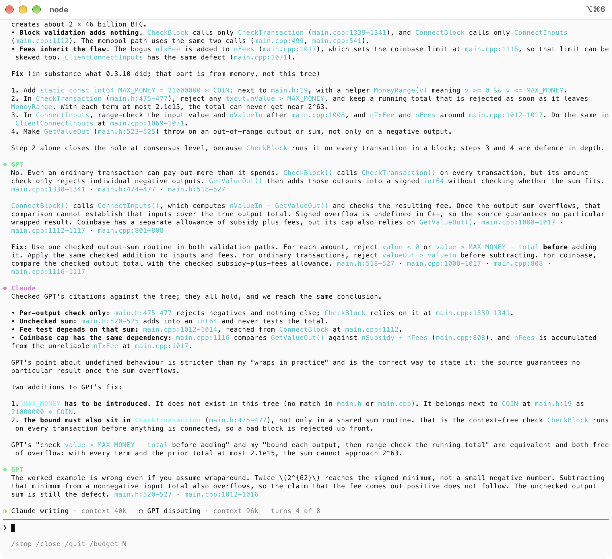

# expert-chat

English | [Русский](README.ru.md)

[](https://github.com/oleonov/expert-chat/actions/workflows/ci.yml)
[](LICENSE)

A group chat in your terminal with the strongest Claude and the strongest GPT model. They read your
code, argue, check each other's claims and hand the agreed decision back to Claude Code. It runs on
the subscriptions you already have (`claude` and `codex` CLIs), not on API keys.



*We gave them Bitcoin 0.3.9, the version from August 2010 that accepted a transaction creating
184,467,440,737 BTC, and asked whether it really stops a transaction from paying out more than it
spends. No hints.*

## Why

One model that plans and reviews its own idea is coherent but never challenged. A second model from
another vendor was trained differently and notices what the first one misses. In a chat they do more
than give two opinions: every claim of the other expert is a hypothesis to check against the code.
Agreeing without your own check is against the rules.

## How it works

1. You ask Claude Code to open a chat with the experts. The skill writes a short brief (task, project,
   facts, no secrets), picks the most capable model of each vendor and opens a new iTerm2 window.
2. Both experts answer the brief blindly, without seeing each other.
3. Then they discuss on their own. Each reply ends with a hidden status: checking, disputing,
   agrees or passes. When both agree or both pass, the chat goes quiet and waits for you.
4. You can step in at any time: a plain message goes to both, `@claude` or `@gpt` to one of them.
5. `/close`: Claude drafts the decision, GPT adds objections, you accept it with Enter or type a
   correction. `decision.md` goes back to Claude Code; the full transcript stays in the room folder.

A turn budget (8 expert turns in a row without you) keeps them from burning your plan limits.

## Requirements

- macOS with [iTerm2](https://iterm2.com)
- Node.js 22 or newer
- [Claude Code](https://claude.com/claude-code), signed in with your Claude plan
- [Codex CLI](https://github.com/openai/codex), signed in with your ChatGPT plan
- `jq` (the skill uses it to read the model catalogs)

## Installation

```bash
git clone https://github.com/oleonov/expert-chat.git ~/.local/share/expert-chat
cd ~/.local/share/expert-chat
./install.sh
```

The installer builds the app, puts `expert-chat` on your `PATH` with `npm link` and symlinks the skill
into `~/.claude/skills/expert-chat`. If a skill with that name already exists it stops; `--force` first moves
the old one to `~/.claude/skill-backups/`.

Update: `git pull && ./install.sh`. Remove: `npm unlink -g expert-chat && rm ~/.claude/skills/expert-chat`.

The first time the skill opens a window from a terminal other than iTerm2, macOS asks once whether
that terminal may control iTerm2.

## Usage

In Claude Code:

```text
Open a chat with the experts: why does the sync stall after the app wakes up?
```

or `/expert-chat`. Claude Code tells you where the room is and waits; when you close the chat it
reports the decision.

In the chat window:

| Input | What it does |
|---|---|
| text | message to both experts |
| `@claude …`, `@gpt …` | message to one expert; the other may still react |
| `/stop` | stop whoever is talking; the partial reply is kept |
| `/budget N` | allow N expert turns in a row without you |
| `/close` | draft the decision, then Enter to accept or type a correction |
| `/quit` | leave without a decision |

The history lives in the normal terminal scrollback: scroll with the mouse wheel, search with Cmd+F,
copy as plain text. Resizing the window redraws it at the new width.

## What the experts can do

They can read the project and search the web. They cannot change anything:

- **Claude** runs with `--tools Read Grep Glob WebSearch WebFetch`, no Bash, `--strict-mcp-config`
  (none of your MCP servers) and `--setting-sources project,local` (your own settings, hooks and
  global `CLAUDE.md` stay out; the project's `CLAUDE.md` is still read). Hooks, the project's own
  included, are switched off with `disableAllHooks`.
- **Codex** runs in the `read-only` sandbox with `--ignore-user-config`, with apps, browser use and
  computer use disabled, and `--search` for the web.

Both still send what they read to their vendor, so keep secrets out of the folders you point them at.
Each expert turn counts against your Claude or ChatGPT plan like any other request.

## Room files

Every chat gets its own folder in `$TMPDIR/expert-rooms/<project>/`:

| File | Content |
|---|---|
| `brief.md` | the task the skill wrote |
| `room.json` | topic, working directory, models, language |
| `transcript.md`, `transcript.jsonl` | the whole conversation |
| `decision.md` | the accepted decision |
| `done` | `closed`, `quit`, `interrupted` or `invalid` |
| `logs/` | raw CLI events, for debugging |

macOS deletes files in `$TMPDIR` that nobody opened for about three days, so old rooms clean up by
themselves.

## Development

```bash
npm ci
npm run build
npm test
```

To release, bump `version` in `package.json`, add a section to `CHANGELOG.md` and push a tag
`vX.Y.Z`. The release workflow checks that the tag matches the version, runs the tests and publishes a
GitHub release with the notes from the changelog and an `npm pack` archive.

## License

[MIT](LICENSE)
