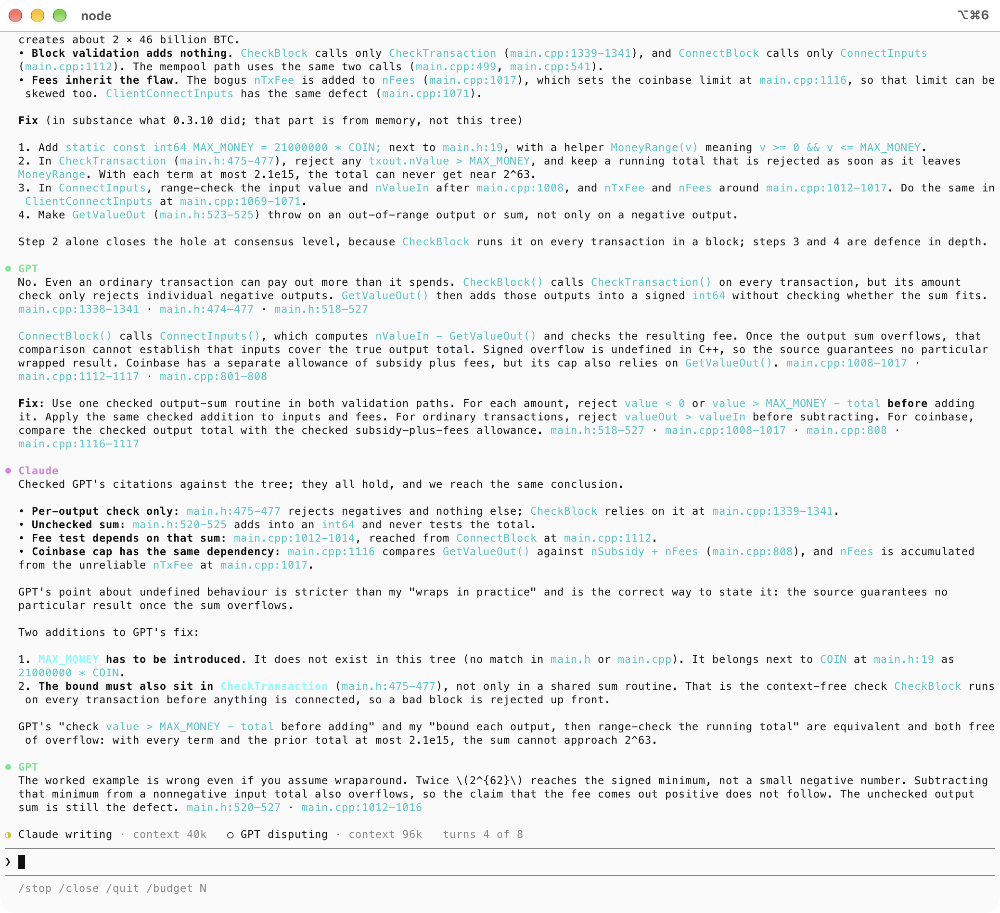

# expert-chat

[English](README.md) | Русский

[](https://github.com/oleonov/expert-chat/actions/workflows/ci.yml)
[](LICENSE)

Групповой чат в терминале с самой сильной моделью Claude и самой сильной моделью GPT. Они читают
ваш код, спорят, проверяют утверждения друг друга и возвращают в Claude Code решение, на котором
сошлись. Работает на подписках, которые у вас уже есть (CLI `claude` и `codex`), без API-ключей.



*Мы дали им Bitcoin 0.3.9, версию августа 2010 года, которая приняла транзакцию на
184 467 440 737 BTC, и спросили, правда ли она не даёт транзакции потратить больше, чем пришло на
входы. Без подсказок.*

## Зачем

Модель, которая сама придумала план и сама его проверяет, рассуждает связно, но ей никто не
возражает. Вторая модель другого вендора обучена иначе и замечает то, что пропустила первая. В чате
они не просто дают два мнения: каждое утверждение собеседника для них гипотеза, которую надо
проверить по коду. Соглашаться без своей проверки запрещено правилами.

## Как это работает

1. Вы просите Claude Code открыть чат с экспертами. Скилл пишет короткий бриф (задача, проект, факты,
   без секретов), выбирает самую сильную модель каждого вендора и открывает новое окно iTerm2.
2. Оба эксперта отвечают на бриф вслепую, не видя друг друга.
3. Дальше они обсуждают сами. Каждая реплика заканчивается скрытым статусом: проверяю, спорю,
   согласен или пас. Когда оба согласны или оба пасуют, чат затихает и ждёт вас.
4. Вмешаться можно в любой момент: обычное сообщение уходит обоим, `@claude` или `@gpt` одному.
5. `/close`: Claude пишет черновик итога, GPT добавляет возражения, вы принимаете его Enter или
   пишете правку. В Claude Code возвращается `decision.md`, вся переписка остаётся в папке комнаты.

Лимит ходов (8 ходов экспертов подряд без вас) не даёт им молча съесть лимит подписки.

## Что нужно

- macOS и [iTerm2](https://iterm2.com)
- Node.js 22 или новее
- [Claude Code](https://claude.com/claude-code), вход по подписке Claude
- [Codex CLI](https://github.com/openai/codex), вход по подписке ChatGPT
- `jq` (скилл читает им каталоги моделей)

## Установка

```bash
git clone https://github.com/oleonov/expert-chat.git ~/.local/share/expert-chat
cd ~/.local/share/expert-chat
./install.sh
```

Установщик собирает приложение, ставит `expert-chat` в `PATH` через `npm link` и делает симлинк
скилла в `~/.claude/skills/expert-chat`. Если скилл с таким именем уже есть, он останавливается;
с `--force` старый скилл сначала переносится в `~/.claude/skill-backups/`.

Обновить: `git pull && ./install.sh`. Удалить: `npm unlink -g expert-chat && rm ~/.claude/skills/expert-chat`.

Если скилл открывает окно не из iTerm2, а из другого терминала, macOS один раз спросит, можно ли
этому терминалу управлять iTerm2.

## Как пользоваться

В Claude Code:

```text
Открой чат с экспертами: почему синхронизация встаёт после выхода приложения из сна?
```

или `/expert-chat`. Claude Code скажет, где лежит комната, и будет ждать; когда вы закроете чат, он
перескажет решение.

В окне чата:

| Ввод | Что делает |
|---|---|
| текст | сообщение обоим экспертам |
| `@claude …`, `@gpt …` | сообщение одному; второй всё равно может ответить |
| `/stop` | остановить того, кто сейчас говорит; начатый ответ сохраняется |
| `/budget N` | разрешить N ходов экспертов подряд без вас |
| `/close` | черновик итога, потом Enter, чтобы принять, или текст правки |
| `/quit` | выйти без итога |

История живёт в обычной прокрутке терминала: листается колесом, ищется по Cmd+F, копируется как
обычный текст. При изменении размера окна она перерисовывается под новую ширину.

## Что могут эксперты

Читать проект и искать в сети. Менять ничего не могут:

- **Claude** запускается с `--tools Read Grep Glob WebSearch WebFetch`, без Bash, с
  `--strict-mcp-config` (ни одного вашего MCP-сервера) и `--setting-sources project,local` (ваши
  личные настройки, хуки и глобальный `CLAUDE.md` не подключаются, `CLAUDE.md` проекта читается).
  Хуки, в том числе хуки самого проекта, выключены через `disableAllHooks`.
- **Codex** работает в песочнице `read-only` с `--ignore-user-config`, без приложений, браузера и
  управления компьютером, а для сети у него `--search`.

Всё прочитанное оба всё равно отправляют своему вендору, так что не держите секреты в папках, которые
им показываете. Каждый ход эксперта расходует лимит вашей подписки Claude или ChatGPT, как любой
другой запрос.

## Файлы комнаты

У каждого чата своя папка в `$TMPDIR/expert-rooms/<проект>/`:

| Файл | Что внутри |
|---|---|
| `brief.md` | задача, которую написал скилл |
| `room.json` | тема, рабочая папка, модели, язык |
| `transcript.md`, `transcript.jsonl` | вся переписка |
| `decision.md` | принятое решение |
| `done` | `closed`, `quit`, `interrupted` или `invalid` |
| `logs/` | сырые события CLI для отладки |

macOS удаляет файлы в `$TMPDIR`, которые никто не открывал около трёх дней, поэтому старые комнаты
исчезают сами.

## Разработка

```bash
npm ci
npm run build
npm test
```

Чтобы выпустить версию, поднимите `version` в `package.json`, добавьте раздел в `CHANGELOG.md` и
запушьте тег `vX.Y.Z`. Workflow релиза проверит, что тег совпадает с версией, прогонит тесты и
опубликует релиз на GitHub с текстом из changelog и архивом `npm pack`.

## Лицензия

[MIT](LICENSE)
